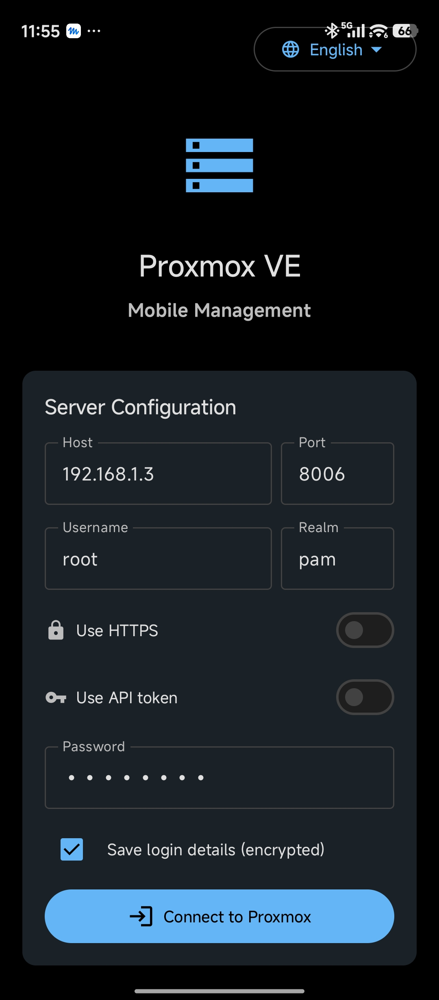
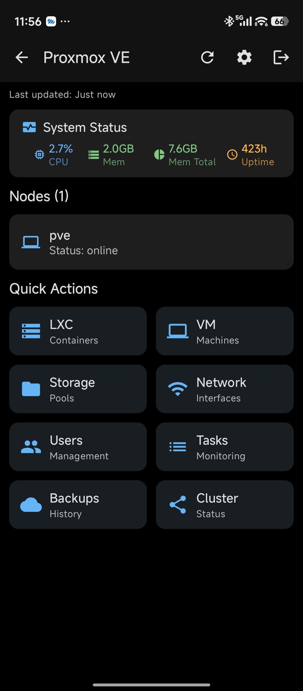
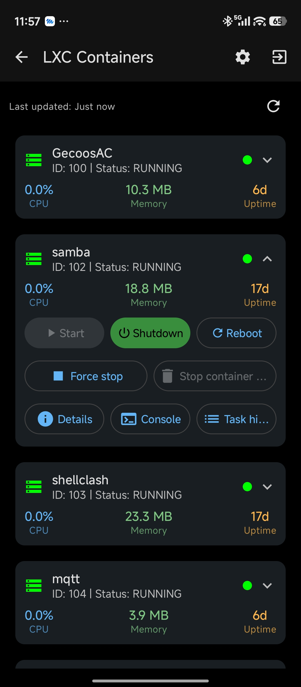
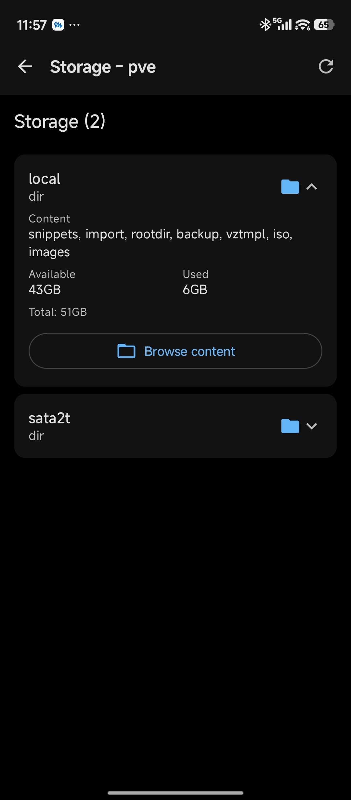

**English** | [简体中文](README.zh-CN.md) | [Deutsch](README.de.md) | [Español](README.es.md) | [Français](README.fr.md) | [日本語](README.ja.md) | [한국어](README.ko.md)

# Proxmox-VE-Android

> This project originates from the upstream [5p00kyy/Proxmox-VE-Mobile](https://github.com/5p00kyy/Proxmox-VE-Mobile) and has been rebuilt as an independent new project, no longer a fork of the upstream. Based on the upstream code, this project includes: translation into 10 languages (English, German, Spanish, Simplified Chinese, French, Italian, Portuguese, Russian, Japanese and Korean) with a language switcher on the login screen; interface refinements including collapsible list cards, a compact system-status card, horizontal quick actions and tidier VM/LXC detail actions; a lightweight WebView guest console for LXC guests (xterm.js) and VM guests (noVNC); working settings for dark/light theme, refresh interval, auto-login and bug reporting; a formally signed 1.0.0 stable release distributed through GitHub Releases, with future releases published automatically when a version tag is pushed; and the app renamed to Proxmox VE Android.

`Proxmox VE Android` is an Android client for browsing and operating a Proxmox VE environment from a phone or tablet.

The current beta line is focused on common mobile operator workflows: login, secure connection handling, dashboard visibility, node navigation, VM/LXC lifecycle actions, task follow-up, and read-only infrastructure inspection. It is a single-module Kotlin/Jetpack Compose app that is moving from screen-owned Retrofit calls toward repository-backed feature slices. This README describes the repository as it exists today rather than the intended end state.

## What's new in 1.0.0

Compared with the first beta, 1.0.0 is the first stable release: [1.0.0](https://github.com/iso-lib/Proxmox-VE-Android/releases/tag/v1.0.0).

- **First stable release.** Version 1.0.0 (versionCode 4), distributed through GitHub Releases and signed with the project's release key. Future releases are published automatically when a version tag (`v*`) is pushed.
- **Guest console.** A lightweight WebView console for LXC guests (xterm.js) and VM guests (noVNC), loading Proxmox's own console pages; password sessions authenticate with a session ticket cookie.
- **Settings that work.** Dark/light theme, a refresh interval of 10–60 seconds for the dashboard, VM, container and task lists, auto-login with saved credentials, and a Report Bug link to GitHub Issues. The biometric and notification switches were placeholders with no implementation behind them, so they were removed.
- **Localization.** The app is translated into 10 languages: English, German, Spanish, Simplified Chinese, French, Italian, Portuguese, Russian, Japanese and Korean. This README is available in 7 languages.
- **Interface refinements.** Collapsible list cards, a compact system-status card (CPU, used/total memory, uptime), horizontal quick actions, a language switcher on the login screen, and tidier VM/LXC detail actions.
- **Login and TLS.** HTTPS normalization for host/IP input, a first-use trust flow for self-signed certificates with SHA-256 fingerprint pinning, and password or API-token login.
- **New name.** Renamed from Proxmox VE Mobile to Proxmox VE Android: the app name, the settings header and the About dialog.

## Release

The current stable release is [1.0.0](https://github.com/iso-lib/Proxmox-VE-Android/releases/tag/v1.0.0) (versionCode 4). See [What's new in 1.0.0](#whats-new-in-100) above for the changes since the first beta.

Distribution:

- GitHub Releases is the download path; the signed APK is attached to each release.
- Future releases are published automatically when a version tag (`v*`) is pushed.
- Play Store and F-Droid packaging are deferred.

Supported environment targets:

- Android API 24 or newer.
- Proxmox VE 8.x is the primary smoke-test target.
- Standalone nodes and small clusters are in scope.
- Proxmox Backup Server management is not in scope.

### Installing The APK

1. Open the GitHub Release for `1.0.0`.
2. Download the attached `proxmox-ve-android-1.0.0.apk`.
3. Confirm the release notes identify the APK as a signed stable build.
4. On Android, allow installation from the browser or file manager you used to download the APK.
5. Open the APK and follow the Android install prompt.

Only install APKs attached to this repository's GitHub Releases. Debug APKs and unsigned workflow artifacts are for project validation only and should not be treated as public downloads.

## Screenshots

Screenshots from version 1.0.0.

| Login | Dashboard |
| --- | --- |
|  |  |
| LXC containers | Storage |
|  |  |

## Localization

The app ships string resources for these locales:

- Default (`values`): English
- `values-de`: German
- `values-es`: Spanish
- `values-zh-rCN`: Simplified Chinese
- `values-fr`: French
- `values-it`: Italian
- `values-pt`: Portuguese
- `values-ru`: Russian
- `values-ja`: Japanese
- `values-ko`: Korean

Localization is resource-based through Android `strings.xml` files. New locale additions should preserve string names, placeholders, format specifiers, and escaping so translations remain behaviorally identical to the default resources.

## Current Status

What appears to work from code inspection:

- Manual login against a user-supplied Proxmox host and port.
- Password or API token login against a user-supplied Proxmox host and port.
- Optional encrypted credential storage with auto-fill on next launch.
- Optional SHA-256 certificate fingerprint pinning for self-signed HTTPS servers.
- Dashboard node listing, basic status display, task activity summary, polling, and manual refresh through a repository-backed feature ViewModel.
- Node detail status loading through a repository-backed feature ViewModel, reachable from dashboard node cards with node identity preserved.
- VM list/detail loading plus start, graceful shutdown, force stop, reboot, delete, returned task notices, direct task-detail links, VMID-filtered task history, and read-only config/snapshot visibility through repository-backed feature ViewModels.
- Container list loading plus start, graceful shutdown, force stop, reboot, delete, returned task notices, direct task-detail links, and VMID-filtered task history through a repository-backed feature ViewModel.
- Container detail status and snapshot visibility through a repository-backed feature ViewModel, reachable from the LXC list with node identity preserved.
- Task history loading through a repository-backed feature ViewModel, with node selection, status/type/VMID filters, detail/status, task log viewing, and running-task stop requests.
- Storage listing and read-only storage content browsing through a repository-backed feature ViewModel with loading, error, refresh, and empty states.
- Network interface listing through a repository-backed feature ViewModel with loading, error, retry, refresh, and cached-node selection.
- User listing through a repository-backed feature ViewModel with loading, error, retry, refresh, and empty states.
- Backup listing through a repository-backed feature ViewModel with node selection, storage filtering, partial-storage warnings, retry, refresh, and empty states.
- Cluster status through a repository-backed read-only screen with quorum, vote, and node membership state.

What is clearly incomplete or only partially implemented:

- Some screens remain placeholders or read-only while planned workflows are built deliberately.
- Some settings are local UI state only and are not persisted or wired into runtime behavior.
- Advanced actions such as node reboot/shutdown/shell, backup mutation, user mutation, VM console/configuration editing, and container detail resource/console operations are outside the first beta scope.
- Backup, user, settings, and LXC-detail controls that are outside beta scope are disabled or labeled read-only rather than presented as working.
- The explicit insecure TLS fallback is debug-only; SHA-256 certificate fingerprint pinning is available for self-signed servers and should be preferred.
- Unit test coverage exists for session/auth, dashboard, node, VM, LXC, task, network, storage, user, backup, security, and localization seams, but broader unit, instrumentation, and screenshot test coverage is still missing.

## Known Limitations

These limitations are expected for `v0.1.0-beta.1` and should be reflected in release notes:

- Guest console access is outside first beta scope.
- VM and LXC configuration editing is outside first beta scope.
- Snapshot create, delete, and rollback are outside first beta scope.
- Backup create, restore, download, and delete are outside first beta scope.
- User create, edit, and delete flows are outside first beta scope.
- Node reboot, shutdown, shell, and advanced service actions are outside first beta scope.
- Storage, network, user, backup, and cluster areas are primarily read-only.
- TFA-specific password login handling is not complete; API token login is the preferred beta workaround where appropriate.
- First-beta smoke QA is required before the beta is tagged; the broader validation matrix continues after the first public beta.

## Tech Stack

- Kotlin
- Jetpack Compose
- Material 3
- AndroidX Navigation Compose
- Retrofit with Gson
- OkHttp
- Kotlin Coroutines
- `EncryptedSharedPreferences` for saved credentials

## Architecture

The project is currently lightweight rather than strongly layered:

- `presentation/`: Compose screens, navigation, and `MainViewModel`
- `data/api/`: Retrofit API definitions plus authentication/client setup
- `data/model/`: API models
- `data/security/`: encrypted credential storage plus credential-store contracts
- `data/session/`: current authentication session ownership and session service contract
- `presentation/auth/`: authentication UI state/session controller
- `data/dashboard/`, `data/node/`, `data/vm/`, `data/lxc/`, `data/task/`, `data/network/`, `data/storage/`, `data/user/`, `data/backup/`, `data/cluster/`: first repository-backed vertical slices

The app is moving toward repository-backed feature slices. Dashboard, node detail, VM list/detail, LXC list/detail, tasks, network, storage, users, backups, and cluster status now use dedicated repositories and feature ViewModels. VM detail now includes read-only configuration and snapshot data through the repository path. Authentication state/API-service access now sits behind `AuthSessionController`, saved login data sits behind `CredentialStore`, and `MainViewModel` still owns cached-node and global dialog concerns. Node detail now preserves node identity when opening VM, LXC, storage, network, and task views.

## Repository Layout

```text
.
|-- app/
|   |-- build.gradle.kts
|   `-- src/main/
|       |-- AndroidManifest.xml
|       |-- java/com/proxmoxmobile/
|       |   |-- data/
|       |   `-- presentation/
|       `-- res/
|-- gradle/
|   |-- libs.versions.toml
|   `-- wrapper/
|-- build.gradle.kts
|-- gradle.properties
`-- settings.gradle.kts
```

## Setup

Prerequisites:

- JDK 17
- Android Studio or a local Android SDK installation

Local setup:

```bash
./gradlew tasks
```

If you want to build locally, create your own `local.properties` or configure the Android SDK through Android Studio. That file is intentionally not tracked.

## Build And Verification

Typical commands in a real Android environment:

```bash
./gradlew assembleDebug
./gradlew assembleRelease
./gradlew test
./gradlew lint
./gradlew compileDebugAndroidTestKotlin
```

For beta release candidates, run the consolidated gate:

```bash
./scripts/beta-gate.sh v0.1.0-beta.1
```

For the final pre-tag check, require completed smoke evidence in the same gate:

```bash
REQUIRE_BETA_QA_COMPLETE=true ./scripts/beta-gate.sh v0.1.0-beta.1
```

To summarize manual beta smoke evidence while QA is in progress:

```bash
./scripts/beta-qa-status.sh
```

Before tagging, run the same summary as a hard completion check:

```bash
./scripts/beta-qa-status.sh --require-complete
```

Android Studio/emulator smoke tests live under [`app/src/androidTest`](app/src/androidTest/README.md) and can be run with:

```bash
./gradlew connectedDebugAndroidTest
```

These tests use placeholder data and do not connect to a Proxmox host. They may reinstall the debug APK or clear saved test credentials, so run them before or after manual logged-in smoke sessions rather than during one.

The 2026-06-06 audit verified `test`, `lint`, and `assembleDebug` locally with JDK 17 and an Android SDK configured through environment variables. Unit coverage currently starts with the session/auth, node, VM, LXC, task, and localization seams; broader behavioral coverage is still needed.

## Project Workflow

- Roadmap and recovery plan: [`docs/development-cycle-2026.md`](docs/development-cycle-2026.md)
- Beta release plan: [`docs/beta-release-plan.md`](docs/beta-release-plan.md)
- Current audit and feature status: [`docs/project-audit-2026-06-06.md`](docs/project-audit-2026-06-06.md)
- Contributor guide: [`CONTRIBUTING.md`](CONTRIBUTING.md)
- Security policy: [`SECURITY.md`](SECURITY.md)
- Changelog: [`CHANGELOG.md`](CHANGELOG.md)

Branch policy:

- `main` is the release branch for public beta tags and release-ready hotfixes.
- `dev` is the integration branch for the next beta cycle.
- Feature and fix branches should be short-lived and target `dev` unless they are release hotfixes.
- Public beta tags are cut from `main` after `dev` is promoted and the beta gate passes.

Pull requests are expected to run `./gradlew test`, `./gradlew lint`, `./gradlew assembleDebug`, and `./gradlew assembleRelease`. The GitHub Actions workflow in `.github/workflows/android.yml` enforces the same baseline for pull requests and pushes to `main` and `dev`.

## Security Notes

- Password credentials and API token pieces can be stored in encrypted shared preferences.
- HTTPS uses platform TLS validation by default.
- Self-signed HTTPS servers can use an Android-trusted imported CA or a pinned SHA-256 certificate fingerprint.
- SSL verification can be disabled only in debug builds for trusted lab servers. Release builds require platform TLS validation or a configured SHA-256 certificate fingerprint.
- Release builds no longer request app-wide cleartext traffic. Debug builds still allow HTTP for local testing.
- See [`SECURITY.md`](SECURITY.md) for the recommended `openssl` command and trust-on-first-use policy notes.

## Privacy Notes

- The app does not include telemetry or analytics.
- Saved host details, usernames, passwords, API token IDs, and API token secrets are stored locally through encrypted shared preferences when credential saving is enabled.
- The app does not intentionally send credentials anywhere except the configured Proxmox VE endpoint.
- Bug reports should remove passwords, API tokens, tickets, cookies, CSRF tokens, private keys, public IP details that should not be shared, and sensitive hostnames.

## Known Gaps

- Automated test coverage is narrow and currently focused on session/auth, dashboard, node, VM, LXC, task, network, storage, user, backup, security, and localization seams.
- CI is present for build, lint, and unit tests.
- Several dependencies and parts of the UI suggest abandoned or unfinished feature work.
- Some settings remain planned or disabled until their runtime behavior is implemented.

## Recommended Next Steps

1. Verify the app on a real Android SDK/emulator and record which screens/actions actually succeed against a Proxmox instance.
2. Validate the self-signed certificate guidance against real Proxmox appliances and reverse proxies.
3. Execute the `v0.1.0-beta.1` smoke matrix and fix only beta blockers before tagging.
4. Promote the changelog from `Unreleased` to `v0.1.0-beta.1` once QA evidence is collected.
5. Continue moving deferred parity work into focused post-beta release trains.

For a concrete staged roadmap, see [`docs/revival-plan.md`](docs/revival-plan.md). For the broader product, refactor, QA, workflow, and community development cycle, see [`docs/development-cycle-2026.md`](docs/development-cycle-2026.md). For the first official beta checklist, see [`docs/beta-release-plan.md`](docs/beta-release-plan.md).
